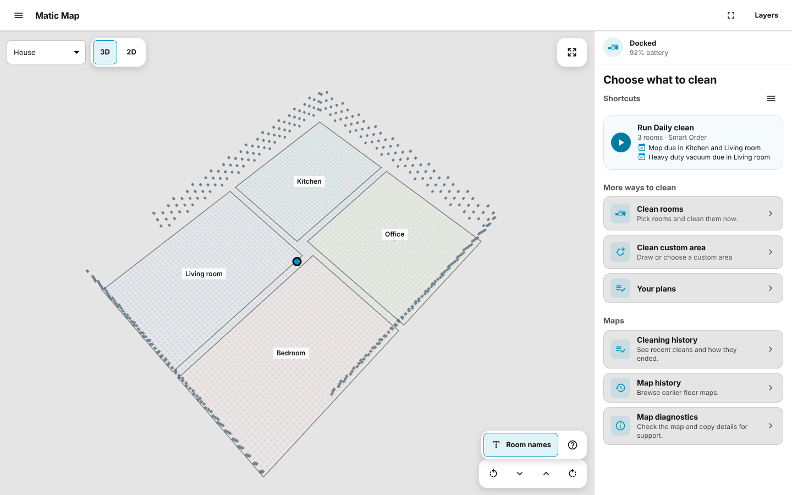

# Matic for Home Assistant

Make Matic part of your home: rotate fairly through rooms, save each room's
cleaning preferences, and start or stop plans as your household comes and goes.
Pair once over Bluetooth; everyday control, maps and state use your local network.

**[Install](#install) · [Guides](docs/README.md) · [Troubleshooting](docs/troubleshooting.md) · [Releases](https://github.com/ProspectOre/matic-home-assistant/releases)**

Matic Map, the sidebar page the integration adds, shown here with a sample home.

## What you get

- **Give every room a turn.** Smart Order starts with the rooms and custom
  areas that have waited longest, so short trips away don't keep restarting the
  same first rooms. Cleans started in the Matic app count too.
- **Plans built around your home.** Save rooms and custom areas in one order,
  each with its own cleaning mode and Quick, Optimal or Heavy duty coverage,
  and preview the next run before it starts.
- **Mop and deep-clean when it's due.** Room schedules mop a room every few
  cleans or rotate its vacuum coverage.
- **Clean around your life.** Run plans when everyone leaves, during quiet
  hours or after a litter-box cycle, with ready-to-import blueprints.
- **Choose how to stop.** Stop now, or let Smart Stop finish the current room
  first.
- **Matic Map.** A photographic 3D map and a 2D plan with the live robot,
  custom areas you draw, cleaning history, saved maps and a Wi-Fi signal layer.
- **Results you can automate.** Events when a room, plan or clean finishes, and
  last-cleaned times for dashboards. Only work the robot confirms counts.

[What Home Assistant adds](docs/features.md) has the full list. The integration
has no telemetry and no cloud service: maps and plans stay in Home Assistant
([privacy](docs/privacy.md)).

## What you need

| | Supported |
| --- | --- |
| Robot | A Matic robot on the same local network as Home Assistant. Add each robot separately. |
| Home Assistant | Home Assistant 2026.10+ |
| Bluetooth | An adapter built into or attached to the Home Assistant host, used for pairing only. Bluetooth proxies can't pair. Home Assistant Container needs a [host setup](docs/hermes-pairing.md#home-assistant-container); a host with no adapter can try the [experimental pairing import](docs/hermes-pairing.md#pair-on-another-device). |
| Robot firmware | The robot updates itself. [Compatibility](docs/firmware-compatibility.md) lists the versions tried so far and the known limits. |
| Access | A Home Assistant administrator, for Matic Map and the assistant tools. |
| Language | English |

## Install

1. In HACS, add [this repository](https://github.com/ProspectOre/matic-home-assistant)
   as a custom **Integration** repository.
2. Download **Matic (Unofficial)** and restart Home Assistant.
3. Open **Settings > Devices & services** and add the discovered Matic. If no
   robot is found, add the integration yourself and enter the robot's address
   and port.
4. Place the robot near Home Assistant's Bluetooth adapter. In the Matic app,
   open **Settings > Connectivity > Add another user** and turn on Pairing mode.
5. Enter the six-digit code shown on the robot. It expires after about 20
   seconds; if it does, turn Pairing mode off and back on and try again.

To install without HACS, download `matic_robot.zip` from a
[release](https://github.com/ProspectOre/matic-home-assistant/releases),
unpack it into `custom_components/matic_robot` in Home Assistant's
configuration directory and restart. The
[pairing guide](docs/hermes-pairing.md) covers Home Assistant Container and
what to do when a code is rejected.

### Updating

Read the [release notes](https://github.com/ProspectOre/matic-home-assistant/releases)
first. Back up Home Assistant, let the robot dock, update through HACS and
restart. Plans, custom areas and the pairing are kept. 0.6 updates from
0.5.4; from 0.4 or older, update to 0.5.4 first. Then open Matic Map and
check that the live map loads; a custom area on a changed map may ask you to
confirm it. To go back to the release you had, restore that backup: an older
release can't always read newer data.

## Use it

Open **Matic Map** from the sidebar to clean rooms, run a plan or draw a custom
area. Use Home Assistant automations to decide when plans run.

| I want to… | Read |
| --- | --- |
| Build plans, choose the order and decide how Stop behaves | [Cleaning and plans](docs/cleaning.md) |
| Mop or deep-clean a room every few cleans | [Room schedules](docs/room-schedules.md) |
| Find my way around the map, its layers and saved maps | [Matic Map](docs/map.md) |
| Clean when I leave, or when another device says so | [Automations and blueprints](docs/automation.md) |
| Build a dashboard | [Entities](docs/entities.md) |
| See everything else | [All guides](docs/README.md) |

## Troubleshooting

Home Assistant raises a Repair for most things it needs from you, so check
**Settings > System > Repairs** first. [Troubleshooting](docs/troubleshooting.md)
then lists what you might see during pairing, on the map and while cleaning,
and how to send a useful bug report.

- [Report a bug](https://github.com/ProspectOre/matic-home-assistant/issues/new?template=bug_report.yml)
- [Community discussion](https://community.home-assistant.io/t/matic-unofficial-local-robot-vacuum-control-map-room-plans-and-intelligent-rotation/1017684)
- Report a security problem privately, through [Security](SECURITY.md).

## Remove

1. Open **Settings > Devices & services > Matic (Unofficial)**, choose ⋮ on
   the robot's entry, then **Delete**.
2. Remove **Matic (Unofficial)** in HACS and restart Home Assistant.

Deleting the entry removes the pairing, plans, custom areas, saved maps and
firmware history from Home Assistant. Backups made earlier still hold copies.
It does not end Home Assistant's access on the robot itself: the integration
has no way to do that, so ask Matic support if you need it
([privacy](docs/privacy.md#removing-the-integration)).

## About

An independent community project, not affiliated with Matic Robots Inc.
Matic is its trademark; this project uses original robot artwork.
For vendor-supported setup, see [Matic's Home Assistant guide](https://support.maticrobots.com/how-to-connect-matic-to-home-assistant).

[MIT license](LICENSE) · [Contributing](CONTRIBUTING.md) · [Roadmap](docs/roadmap.md)

Buying a robot? The maintainer may receive store credit through this
[optional referral link](https://referrals.maticrobots.com/maticrobots/u/dbaef97f?sub=maticrobots).
